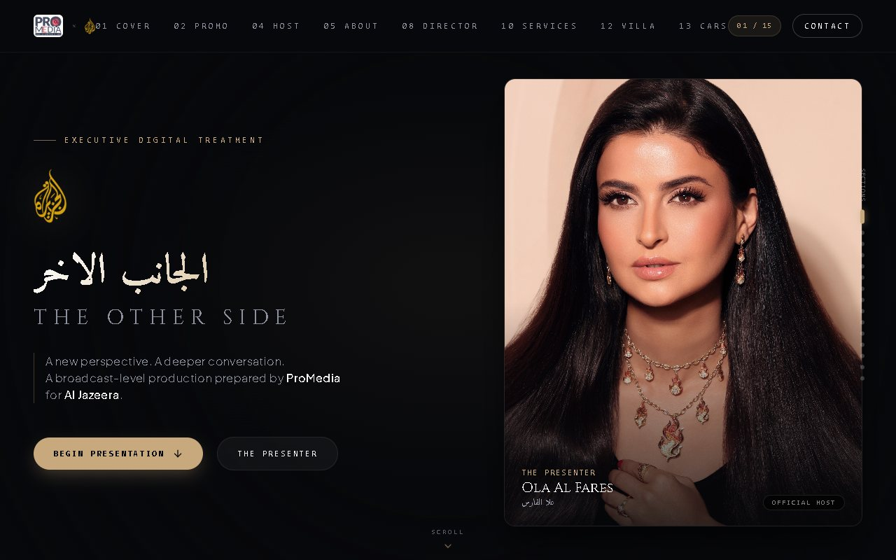

# ProMedia × Al Jazeera — Interactive Broadcast Partnership & Production Presentation



🌐 **Live Presentation:** [promedia-aljazeera-presentation.vercel.app](https://promedia-aljazeera-presentation.vercel.app/)  
🏢 **Presenting Agency:** **ProMedia**  
👨‍💻 **Digital Presentation Engineering:** [Mostafa Mohamed Farhat (Elshorbagy)](https://mostafa-portfolio-iota.vercel.app/)

---

## Overview

An interactive media partnership and production capability presentation prepared by **ProMedia** for **Al Jazeera**, showcasing studio infrastructure, regional documentary/program production workflows, and creative execution capacity.

### Key Highlights
- **Executive Broadcast Deck:** Multi-slide interactive web presentation tailored for broadcast media stakeholders.
- **Studio & Location Visuals:** Integrated photography and production facility galleries.
- **Responsive Presentation Engine:** Built with clean HTML5, CSS3, and modular JavaScript for zero-latency playback across desktop and conference room displays.

---

## Running Locally

```bash
npx serve .
```
